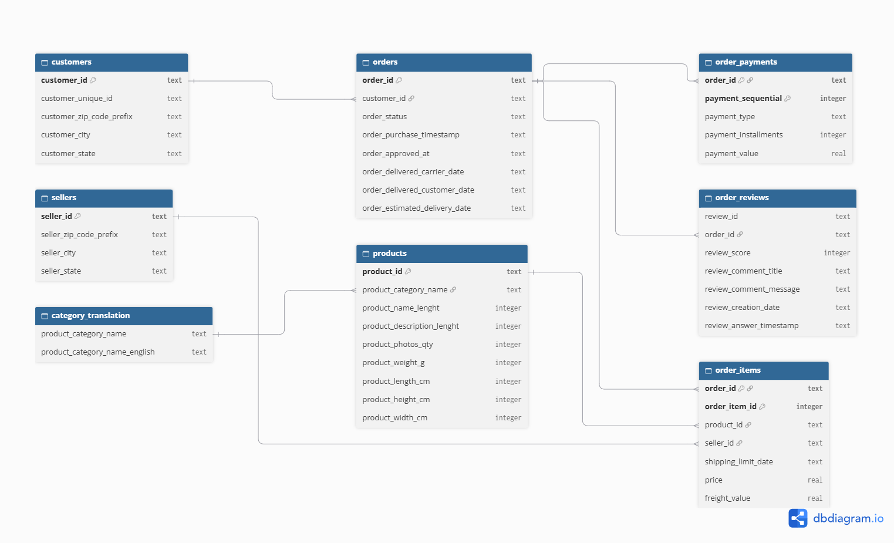

# Olist E-Commerce SQL Analysis

SQL analysis of ~100K orders from a Brazilian e-commerce marketplace (Olist), covering revenue trends, delivery performance, customer retention and segmentation.

**Tools:** SQL (SQLite), DB Browser for SQLite
**Skills shown:** joins across 8 tables, CTEs, window functions (`LAG`, `RANK`, `NTILE`, running `SUM`), cohort analysis, RFM segmentation, data cleaning
**Data:** [Brazilian E-Commerce Public Dataset by Olist](https://www.kaggle.com/datasets/olistbr/brazilian-ecommerce) (Kaggle)
**Period covered:** Oct 2016 to Aug 2018

## Database schema



Eight tables: `customers`, `orders`, `order_items`, `order_payments`, `order_reviews`, `products`, `sellers`, `category_translation`.

## Repository structure

```
sql/
  01_schema.sql      table definitions
  02_cleaning.sql    data quality checks
  03_analysis.sql    13 business questions
images/              ERD and result screenshots
```

## Key findings

| # | Finding |
|---|---|
| 1 | Revenue reached R$15.42M (delivered orders), growing about 6x through 2017 and then flattening at roughly R$1.0-1.1M per month in 2018 |
| 2 | Growth came from order volume, not larger baskets: average order value stayed at about R$150-170 |
| 3 | Sao Paulo alone is 37.4% of revenue; SP, RJ and MG together are about 62.5% |
| 4 | Late deliveries (8% of orders) average 2.57 review stars vs 4.29 for on-time orders |
| 5 | Only 3.0% of customers ever bought twice; month-1 cohort retention averages about 0.5% |
| 6 | High-value customers are 47% of customers but 75% of revenue |

## Data quality findings

- 97% of orders (96,478 of 99,441) are `delivered`; analysis filters to delivered orders.
- 8 delivered orders have no delivery date; excluded from delivery-time metrics.
- 775 orders have no line items (mostly canceled or unavailable); they drop out of product analysis.
- 547 orders have multiple reviews; reviews were reduced to one score per order to avoid double counting.
- 610 products have no category; grouped as `unknown`.
- 3 payments have type `not_defined` with value R$0.
- 2016 data is sparse (Dec 2016 has 1 order, Nov 2016 is missing), so growth rates start from Jan 2017.
- Customers are identified by `customer_unique_id`, because `customer_id` is generated per order.
- One delivered order has no payment record, so customer counts differ by 1 between Q8 and Q13.

## Analysis

### Basic

**Q1: Monthly revenue and orders**
Insight: Revenue grew from R$128K (Jan 2017) to R$1.15M (Nov 2017, Black Friday peak), then plateaued around R$1.0-1.1M per month through Aug 2018. Average order value stayed flat (~R$150-170), so growth came from order volume, not larger baskets. 2016 data is sparse and was excluded from trend conclusions.
Recommendation: Since order volume drives revenue, focus on acquisition and retention rather than price increases. Plan inventory and logistics for November peaks, and investigate the mid-2018 plateau.

**Q2: Top product categories by revenue**
Insight: health_beauty (R$1.23M), watches_gifts (R$1.17M) and bed_bath_table (R$1.02M) lead on revenue; the top 10 categories total about R$8.25M. Order volume and revenue rank differently: bed_bath_table has the most orders (9,272) but only ~R$110 per order, while watches_gifts earns ~R$212 per order from far fewer orders.
Recommendation: Treat high-ticket categories (watches_gifts, cool_stuff, auto) as margin drivers and push premium bundles. For high-volume, low-ticket categories, use cross-sell and free-shipping thresholds to raise basket size.

**Q3: Revenue by state**
Insight: Revenue is highly concentrated: Sao Paulo generates 37.4% (R$5.77M), and SP + RJ + MG generate about 62.5%. The bottom 10 states each contribute under 0.5%. Average order value is lowest in SP (~R$143) and much higher in remote states (e.g. PB ~R$267), which may reflect higher freight costs (not verified).
Recommendation: Protect and deepen the Southeast core with retention campaigns. Treat the North and Northeast as growth markets, but check whether high shipping costs limit order volume.

**Q4: Average payment by payment type**
Insight: Credit card is the dominant method (~75% of orders), followed by boleto (~19.5%). Credit card payments average R$163 vs R$145 for boleto (+13%), likely because installments make larger purchases easier. Voucher payments average only R$66, but vouchers are often partial payments.
Recommendation: Keep credit card installments prominent at checkout. Offer incentives for boleto customers to pay upfront.

### Intermediate

**Q5: Delivery time by state**
Insight: Average delivery takes 8.8 days in SP but 24-29 days in remote states (RR, AP, AM, AL), about 3x longer. Actual delivery beats the estimate in every state by 8-20 days, so estimates are conservative. AL, MA and SE have the smallest buffer (8-9 days) while also being slow (21-25 days).
Recommendation: Add regional fulfilment or carrier partnerships for the North and Northeast, and recalibrate estimates by state.

**Q6: Late deliveries vs review score**
Insight: 8% of delivered orders (7,661) arrived after the estimated date. Their average review score is 2.57 vs 4.29 for on-time orders, a drop of 1.72 points (~40%).
Recommendation: Reducing late deliveries is the clearest lever for improving ratings. Prioritise the slow regions from Q5 and send proactive delay notifications.

**Q7: Top 10 sellers**
Insight: The top 10 sellers generate ~R$1.75M, and 9 of 10 are in SP. Average ratings range from 3.50 to 4.37. Two high-volume sellers (3.50 and 3.85) rate below the rest, so large revenue and customer satisfaction do not always go together.
Recommendation: Monitor top sellers with low ratings, set rating thresholds with improvement plans, and reward high-revenue, high-rating sellers with better visibility.

**Q8: Repeat customer rate**
Insight: Only 3.0% of customers (2,801 of 93,358) placed more than one delivered order. Combined with Q1, this shows growth came from acquiring new customers rather than retention. The dataset covers about 2 years, so recent customers had limited time to return.
Recommendation: Retention is the biggest opportunity. Test post-purchase emails and second-order discounts, and fix delivery delays (Q6) that damage the first experience.

### Advanced

**Q9: Month-over-month revenue growth**
Insight: From Feb 2017, revenue grew in 7 of 9 months through Oct 2017, then jumped 53.6% in Nov 2017 (Black Friday) before falling 26.9% in Dec. In 2018, growth stalled: monthly changes stayed between +1.6% and -10.3% from Apr to Aug, leaving Aug 2018 about 13% below the Apr peak. 2016 months were excluded from growth rates.
Recommendation: Plan stock and marketing for Black Friday and expect a December dip. Investigate the 2018 plateau and prioritise retention over pure acquisition. Treat Aug 2018 with caution, as the dataset may end before the month completes.

**Q10: Top products within each category (RANK)**
Insight: Using `RANK()` with `PARTITION BY category`, the top 3 products were identified in every category. Concentration varies widely: in `art` the best product earns R$10.6K vs R$488 for the third, while in `audio` the top three are close (R$9.4K-R$13.0K).
Recommendation: Protect stock of single-product-dependent categories, since one stockout could hit category revenue. Use best-sellers as anchors for bundles and cross-sell.

**Q11: Running total of revenue**
Insight: Cumulative revenue reached R$15.42M by Aug 2018 (matching the state total in Q3). It passed R$1M in Apr 2017, R$5M in Nov 2017 and R$10M in Mar 2018. Jan-Aug 2018 revenue (R$8.45M) was ~2.4x the same period in 2017 (R$3.47M), but monthly additions flattened at R$1.0-1.1M in 2018.
Recommendation: Use the cumulative curve for yearly targets, and treat the flat 2018 slope as a signal that growth now needs retention and logistics improvements, not just more acquisition.

**Q12: Cohort retention**
Insight: Customers were grouped by first-purchase month and tracked for 6 months. Month-1 retention averages only ~0.5% (range 0.18%-0.72%), and month-6 retention is 0.11%-0.42%. Retention is flat rather than decaying gradually, so repeat purchases look sporadic rather than habit-driven. The Nov 2017 Black Friday cohort (7,060 customers) had the lowest month-6 retention (0.11%). Tiny 2016 cohorts were ignored, and later cohorts have fewer months due to the Aug 2018 data cutoff.
Recommendation: Add a post-purchase retention program (follow-up offer at 30 days, loyalty incentive) and measure its effect on month-1 retention. Treat Black Friday customers as a separate segment with a win-back campaign. Test whether late first deliveries reduce repeat purchases.

**Q13: RFM segmentation**
Insight: Customers were scored on recency (quartiles), frequency (1, 2, 3+) and monetary value (quartiles). High-value customers (New High-Value + Lost High-Value) are 47% of customers but 75% of revenue (R$11.6M), spending ~R$262 on average vs ~R$63 for low-value customers. Only 3% of customers (Champions + At Risk) are repeat buyers. "Lost" means a last order in the older half of the data period, not confirmed churn.
Recommendation: Run a win-back campaign for the 21,738 Lost High-Value customers (R$5.75M historical revenue) and a second-purchase offer for the 22,473 New High-Value customers. Offer At Risk repeat buyers a loyalty reward before they lapse.

| Segment | Customers | % of customers | Revenue (R$) | Avg spend (R$) |
|---|---|---|---|---|
| New High-Value | 22,473 | 24.07% | 5,870,842 | 261.24 |
| Lost High-Value | 21,738 | 23.28% | 5,747,262 | 264.39 |
| Lost / Low-Value | 23,683 | 25.37% | 1,511,988 | 63.84 |
| New Customers | 22,662 | 24.27% | 1,428,012 | 63.01 |
| Champions | 1,543 | 1.65% | 485,868 | 314.89 |
| At Risk | 1,258 | 1.35% | 378,489 | 300.87 |

## Limitations

- The data covers about 2 years, so some customers classed as lost or non-returning may still return.
- Revenue in Q1, Q3 and the monthly trend queries uses `payment_value` (includes freight); Q2 and Q7 use `price` (product revenue only).
- Correlations (e.g. late delivery and low ratings) are not proof of causation.
- The dataset may be a sample of Olist's actual orders.

## How to reproduce

1. Download the dataset from Kaggle and extract the CSVs.
2. Create a SQLite database and run `sql/01_schema.sql`.
3. Import each CSV into its table (skip the geolocation file).
4. Run `sql/02_cleaning.sql`, then `sql/03_analysis.sql`.
